# 02 — Carte de l'architecture réelle (commit `4e1d8ed1`, en production le 2026-11-10)

> Ce qui EXISTE et tourne, lu dans le code, le build, les en-têtes servis et le catalogue de production — pas ce que
> disent les documents (`docs/ARCHITECTURE.md` décrit encore un monolithe unique et Leaflet : périmé).

## Diagramme

```mermaid
flowchart TB
  subgraph Appareil["Appareil de la personne (frontière : tout y est public et modifiable)"]
    Page["Page index.html (391 Ko minifiée)<br/>~35 scripts inline : garde d'accès, textes légaux,<br/>réglages distants, télémétrie, première visite, lots d'interface"]
    Chargeur["Chargeur inline<br/>9 scripts app/ en parallèle, exécutés dans l'ordre,<br/>empreinte integrity sur chacun"]
    App["Bloc app (app-01 … app-09)<br/>fonctions globales, pas de modules"]
    SW["Service worker sw.js<br/>cache passio-v&lt;buildId&gt;, page au réseau d'abord"]
    LS[("localStorage<br/>état, conversations, files hors ligne,<br/>pierres tombales, jeton de session")]
    IDB[("IndexedDB<br/>conversations")]
    Page --> Chargeur --> App
    App <--> LS
    App <--> IDB
    SW -. sert et met en cache .-> Page
  end

  subgraph Netlify["Netlify — passio-app.netlify.app"]
    Statique["dist/ : page, app/, styles.css, sw.js,<br/>release.json, pilotage/, data/, fonts/, js/vendor/"]
    Bord["Fonctions de bord<br/>/p /u /e aperçus · /media renvoi 301 · /demo images d'exemple"]
    Entetes["_headers + netlify.toml<br/>CSP, caches"]
  end

  subgraph Supabase["Supabase — projet de production (PostgreSQL 17, forfait Pro)"]
    Auth["Auth<br/>e-mail + mot de passe, Google,<br/>confirmation par e-mail"]
    Rest["PostgREST<br/>54 tables, RLS partout,<br/>133 policies, 144 fonctions"]
    Realtime["Realtime<br/>canaux privés user: fil: conv: typing: …<br/>poussés par déclencheur (publication vide)"]
    Stockage["Storage<br/>content (public) · attachments (privé)"]
    Fonctions["5 fonctions Edge<br/>ask-ai · delete-account · export-account ·<br/>notify-call · pilotage"]
    Cron["pg_cron : 10 tâches<br/>purges, agrégats, veille toutes les 5 min"]
    BDD[("Base")]
    Rest --- BDD
    Realtime --- BDD
    Fonctions --- BDD
    Cron --- BDD
  end

  subgraph GitHub["GitHub — dépôt PUBLIC PASSIO74/passio-app"]
    CI["deploy.yml : gouvernance, audits, suites à comptes réels (staging),<br/>6 lots navigateur, WebKit, gates artefact, déploiement"]
    Veilles["Crons : veille, disponibilité, Sentinelle, digest,<br/>modération, sauvegarde nocturne"]
    Agent["claude-code.yml : agent distant<br/>(issue ET ordre de PASSIO74 exigés)"]
  end

  subgraph Poste["Poste de Benjamin"]
    Dash["dashboard/ : pilotage local (Node),<br/>lecture service_role, réparation en worktree"]
    Migr["Migrations : canal ③<br/>appliquer-migration.mjs, jeton personnel"]
  end

  Tiers["Tiers appelés par l'appareil<br/>Brevo (e-mails, via Supabase) · Cloudflare Turnstile et TURN ·<br/>KLIPY / Giphy · OpenFreeMap · BAN · Photon · STUN Google"]

  App -- "HTTPS, clé anon publique + jeton de session" --> Rest
  App --> Auth
  App <-- "WebSocket" --> Realtime
  App --> Stockage
  App --> Fonctions
  App -. "télémétrie, erreurs" .-> Rest
  Page -- "GET" --> Statique
  App --> Tiers
  Bord -- "lecture anonyme" --> Rest
  CI -- "netlify deploy --prod" --> Statique
  CI -- "edge-functions.yml" --> Fonctions
  Veilles -- "lectures" --> Rest
  Veilles -- "archives chiffrées" --> GitHub
  Migr -- "DDL" --> BDD
  Dash -- "service_role, lecture" --> BDD
  Fonctions -- "pilotage : gestes" --> GitHub
```

## Composants

| Composant | Rôle | Source de vérité | Données détenues | Dépend de | Modes de défaillance | Diagnostic et récupération |
|---|---|---|---|---|---|---|
| **Page + scripts inline** | écran, garde, textes légaux, télémétrie, première visite, lots d'interface | `index.html`, `js/*.js` assemblés par `scripts/build.js` | aucune | Netlify | page servie sans ses scripts ; minification fautive (non testée : STAB-10) | `release.json` dit la version servie ; `npm run rollback:netlify` |
| **Chargeur + bloc app** | toute la logique (état, fil, messagerie, IRL, profil, boot) | `js/app-01…09` ; ordre = dépendances | état en mémoire | la page, `integrity`, le cache HTTP | un script manquant ou refusé arrête le démarrage **sans message** (PWA-02) ; écouteurs rejouables (STAB-01, corrigé #822) | console ; `app-scripts-par-fichier.spec.js` |
| **Service worker** | cache par version, page au réseau d'abord, notifications push | `sw.js`, cache `passio-v<buildId>` | copies des fichiers versionnés | `release.json` | réseau présent mais muet : écran blanc (PWA-01) ; page rechargée après chaque déploiement (PWA-06) | le cache change à chaque build ; plafond de 24 h |
| **État local** | compte, profils, brouillons, réglages, files, pierres tombales | l'appareil — puis `user_state` côté serveur | `passio_mvp_state_v1`, `passio_conversations_v1` (+ IndexedDB), `passio_outbox_v1`, `passio_cmt_outbox_v1`, `passio_uid`, `sb-<ref>-auth-token` | — | un instantané ancien écrase un plus récent (ETAT-01) ; état illisible → vide en silence (ETAT-13) ; clés hors purge de compte (ETAT-12) | `purgeAccountScopedData`, adoption de compte au démarrage |
| **Supabase Auth** | identité | Supabase | comptes, sessions | Brevo pour les e-mails | déconnexion globale par défaut (ETAT-02) ; aucun écouteur `SIGNED_OUT` (R19) ; lien expiré muet | mode « session expirée » ; réglages hors catalogue : **non vérifiés** |
| **PostgREST + RLS** | **seule frontière de sûreté** (ADR-003) | la base de PRODUCTION, pas les migrations | toutes les données | — | policy manquante = écriture à 0 ligne, sans erreur (SRV-03, SRV-04) | canal ① en lecture ; `authz-critical` à chaque push |
| **Realtime** | messages, notifications, fil en direct | déclencheurs → canaux privés | `realtime.messages` (quelques jours) | Auth | mur de 500 connexions simultanées (PERF) ; révocation en cours de session non vérifiée | `controle-realtime.yml` ; filets de relecture côté client |
| **Storage** | médias | Supabase | `content` (public), `attachments` (privé) | CDN Supabase | média d'un compte privé lisible par son URL (connu, écrit dans les textes légaux) | quotas par compte ; `medias:orphelins` |
| **Fonctions Edge** | suppression et export de compte, push d'appel, IA, pilotage | `supabase/functions/` — déployées par `edge-functions.yml`, **à part** de l'application | secrets (service_role, VAPID, Anthropic, jetons GitHub) | Supabase | révision servie ≠ dépôt | en-tête `X-Passio-Revision` sur chaque réponse |
| **Fonctions de bord Netlify** | aperçus de partage, renvoi des anciens médias, images d'exemple | `netlify/` | aucune | Supabase en lecture anonyme | image d'exemple non mise en cache (PERF-04) | tout échec rend un aperçu générique ou un 302 |
| **CI/CD** | tests, build, déploiement | `.github/workflows/` | secrets GitHub | GitHub, Netlify, staging Supabase | la page minifiée n'est pas testée (STAB-10) ; `netlify-cli` sans lockfile (EXPL-04) | `gh run view` ; 17,4 min de médiane push → en ligne |
| **`/pilotage/` + fonction `pilotage`** | pilotage en ligne, sur l'origine publique | page statique + fonction | réglages distants, gestes | session Supabase du compte éditeur | **un seul facteur** (PIL-01) ; six gestes sans trace (PIL-08) | la décision est toujours prise au serveur |
| **`dashboard/`** | pilotage local, réparation | poste de Benjamin | télémétrie lue en `service_role` | le poste allumé | hors build, hors Netlify : **une livraison de l'application ne dit rien de lui** | `dashboard/README.md` |
| **Veilles et Sentinelle** | détection, enquête, alerte | crons GitHub + `pg_cron` | issues, digest | GitHub | crons servis avec retard : panne totale vue en 5,7 h de médiane (EXPL-06) ; sauvegarde en échec lue « ok » (EXPL-02) | `gh run list` par workflow |
| **Sauvegardes** | archives nocturnes chiffrées | `sauvegarde.yml` | tables, comptes, médias le dimanche | GitHub | déchiffrement jamais éprouvé (EXPL-01) | restauration éprouvée sur le staging (14/09, 15/09, 21/10) |

## Couplages, duplications d'état, points uniques

- **Un seul espace de noms** : ~3 400 globals sur `window`, ordre de chargement = graphe de dépendances. Tenu par deux gates
  (`audit-globals`, `audit-handlers`). Un commentaire qui cite un attribut suffit à faire rougir un gate ou un test « à la source »
  (vécu deux fois pendant cette mission) : la lecture du code source par les tests est un couplage à connaître.
- **Trois copies de l'état d'un compte** : mémoire, `localStorage` / IndexedDB, `user_state`. Les fusions sont en UNION (ajout seul)
  pour suivis, blocages et inscriptions : un retrait ne converge pas (ETAT-08).
- **Trois identités confondues par la forme** : la plupart des gardes regardent si `MY_UID` a la forme d'un uuid, pas si une session
  existe (ETAT-02).
- **Échappement = seule barrière contre une XSS** : la CSP porte `script-src 'unsafe-inline'` (gestionnaires inline partout). Une
  interpolation oubliée est exécutable (CLI-01).
- **L'origine de l'application est aussi celle du pilotage** : un script exécuté chez le propriétaire commande le pilotage (PIL-01).
- **Points uniques** : un seul compte GitHub (propriétaire, relecteur, fusion) ; un seul projet Supabase de production ; un poste pour
  les migrations et le dashboard ; le chargeur inline.
- **Trois livraisons indépendantes** : application (Netlify), fonctions Edge, migrations. Aucune ne prouve les autres.

## Faut-il transformer la structure ? Les trois voies, comparées

| | Conserver tel quel | Amélioration progressive (**recommandée**) | Refonte ciblée (modules, bundler, framework) |
|---|---|---|---|
| Bénéfice | aucun coût | ferme les défauts MESURÉS : verdict lu sur chaque écriture, identité lue sur la session, état par remplacement après lecture réussie, artefact final testé | supprimerait la classe « global écrasé » et « interpolation oubliée » |
| Risque de régression | nul | faible, lot par lot, chaque lot avec son verrou | élevé : 2 587 tests écrits contre des fonctions globales et des gabarits de chaînes |
| Coût | — | une à trois semaines de lots bornés | plusieurs mois, pendant lesquels rien d'autre n'avance |
| Migration progressive | — | par nature | possible seulement écran par écran, avec deux mondes à tenir |

**Aucun défaut trouvé par cet audit n'est causé par l'absence de framework ou par la taille des fichiers** : ils viennent d'écritures
dont le verdict n'est pas lu, d'une identité décidée sur une forme, et d'un contrôle absent côté serveur. ADR-001 (vanilla, sans
bundler) n'a pas à être rouvert, et **aucun ADR nouveau n'est nécessaire** : rien de structurel n'est proposé.
